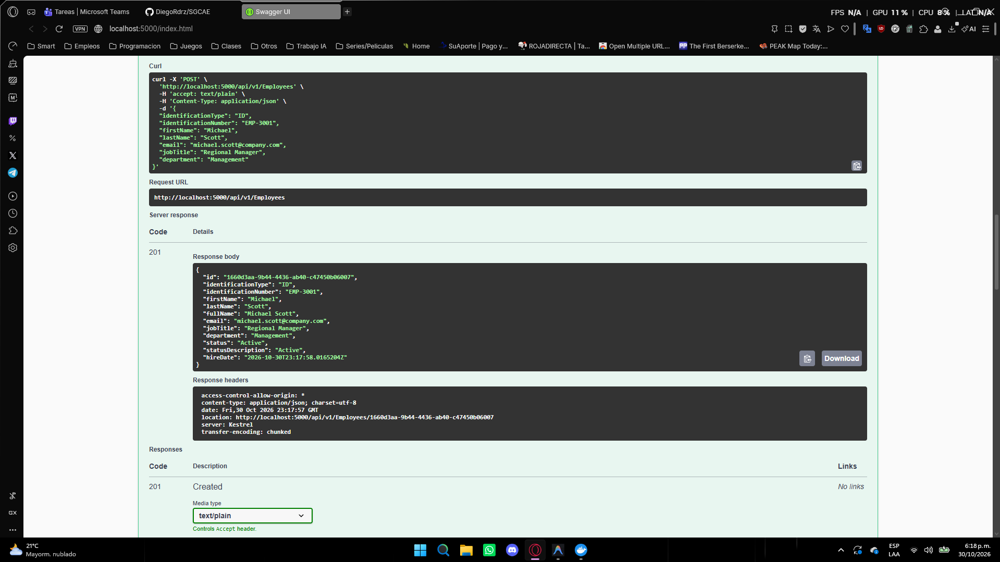
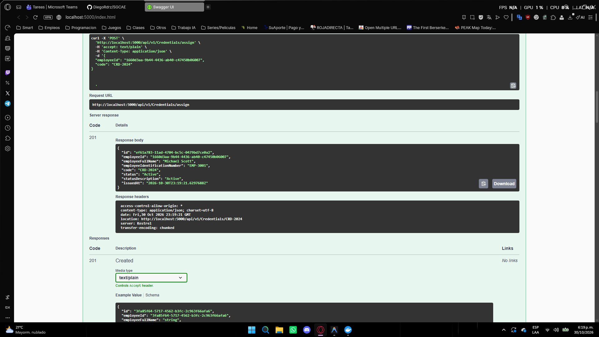
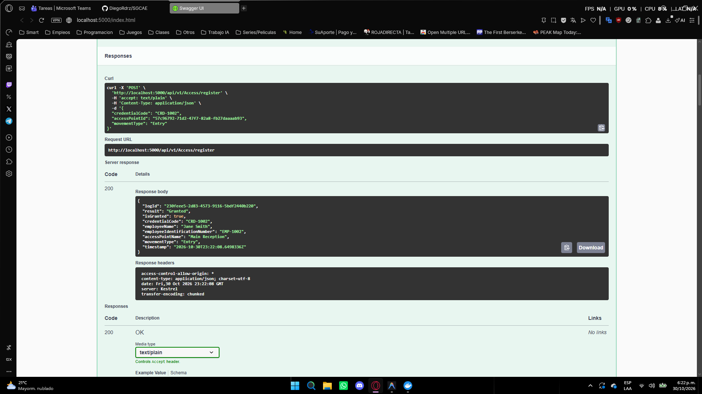
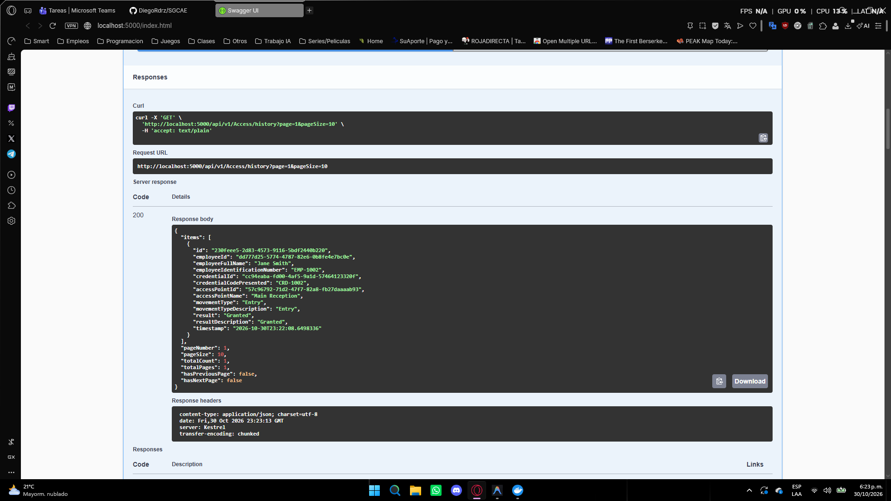
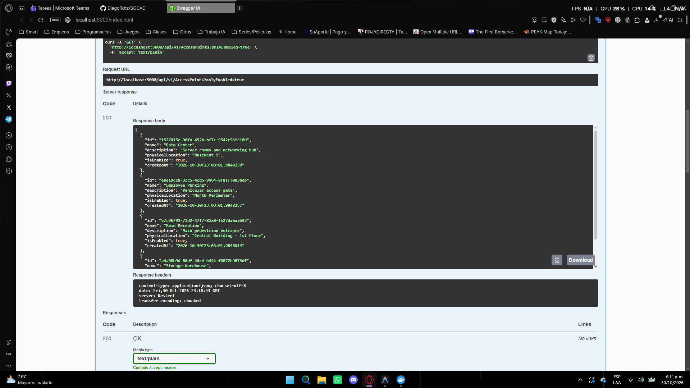

# SGCAE - Employee Access Control and Management System

Backend solution built with ASP.NET Core (.NET 8) for managing, controlling, and auditing employee access in logistics and storage facilities.

The project follows Clean Architecture, Domain-Driven Design (DDD), and CQRS (Command Query Responsibility Segregation) patterns, persisted via Entity Framework Core on Microsoft SQL Server.

---

## Running with Docker (Single Command)

To run the complete environment (SQL Server database and Web API) using Docker Compose:

```bash
docker compose up --build
```

Once the containers are running:
* **Interactive Swagger UI:** http://localhost:5000
* **SQL Server:** Port `1433` (User: `sa`, Password: `Sgcae2024*`)

The API automatically applies pending Entity Framework Core migrations and seeds initial test data upon startup.

---

## Solution Structure

The project is structured according to Clean Architecture layers:

```
Seguimiento 2/
├── src/
│   ├── SGCAE.Domain/                     # Entities, Value Objects, Enums, and Invariants
│   │   ├── Common/
│   │   ├── Entities/                     # Employee, Credential, AccessPoint, AccessLog
│   │   ├── Enums/                        # EmploymentStatus, CredentialStatus, MovementType, AccessResult
│   │   └── ValueObjects/                 # Email
│   │
│   ├── SGCAE.Application/                # Commands, Queries, DTOs, and Validators (CQRS)
│   │   ├── AccessControl/
│   │   ├── AccessPoints/
│   │   ├── Credentials/
│   │   ├── Employees/
│   │   └── Common/                       # ValidationBehavior, PagedResult, Interfaces
│   │
│   ├── SGCAE.Infrastructure/             # Persistence, EF Core Configurations, Migrations, and Seeder
│   │   ├── Persistence/
│   │   │   ├── Configurations/
│   │   │   ├── Migrations/
│   │   │   └── ApplicationDbContextInitialiser.cs
│   │
│   └── SGCAE.WebApi/                     # REST Controllers, Middlewares, and Configuration
│       ├── Controllers/                  # Employees, Credentials, AccessPoints, Access
│       ├── Middlewares/                  # ExceptionHandlingMiddleware (RFC 7807)
│       └── Program.cs
│
├── tests/
│   └── SGCAE.UnitTests/                  # Unit tests for Domain and Use Cases
│       ├── Domain/
│       └── Application/
│
├── assets/
│   ├── postman/                          # Ready-to-import Postman Collection
│   │   └── SGCAE_API.postman_collection.json
│   └── screenshots/                      # Verification evidence captures
│
├── Dockerfile
├── docker-compose.yml
└── SGCAE.sln
```

---

## Functional Requirements Covered

| Code | Module | Description |
| :--- | :--- | :--- |
| **RF-01** | Employee Management | Create, retrieve, update, and deactivate employees. Enforces unique identification numbers and emails. Deactivating an employee automatically revokes all active credentials. |
| **RF-02** | Credential Management | Issue, query, suspend, and revoke credentials. Enforces maximum one active credential per employee and restricts assignment to inactive employees. |
| **RF-03** | Movement Registration | Validates access requests (Entry/Exit) against access point availability, credential status, and active employment. Records granted and denied movements with explicit reasons. |
| **RF-04** | Access History Audit | Paginated and filterable queries by date range, employee, access point, and validation outcome. |
| **RF-06** | Access Points Administration | Registers physical locations (Reception, Warehouse, Parking, Restricted Zones) with enable/disable status control. |

---

## Pre-seeded Initial Data

The database initializes with the following demo records:

### Access Points
* **Main Reception** (Enabled)
* **Storage Warehouse** (Enabled)
* **Employee Parking** (Enabled)
* **Data Center** (Enabled - Restricted)
* **Maintenance Workshop** (Disabled)

### Employees and Credentials
* **John Doe** (Active) - Credential `CRD-1001` (Active)
* **Jane Smith** (Active) - Credential `CRD-1002` (Active)
* **Robert Brown** (Inactive) - Credential `CRD-9999` (Revoked)
* **Emily White** (Active) - Credential `CRD-8888` (Suspended)

---

## Verification Evidence (Screenshots)


### RF-01: Employee Management (Registration & Query)


---

### RF-02: Credential Management (Issuance & Status Change)


---

### RF-03: Real-Time Access Validation (Entry & Exit Control)


---

### RF-04: Paginated Access Audit History


---

### RF-06: Physical Access Points Administration


---

## Unit Testing

To execute the automated test suite:

```bash
dotnet test
```

The test suite covers:
* `Employee` aggregate domain invariants.
* `Credential` and `AccessPoint` lifecycle state transitions.
* `RegisterAccessMovementCommand` scenarios (access granted, rejection due to suspended/revoked credentials, inactive employee, unknown credential, or disabled access point).

---

## Postman Testing

The `assets/postman/SGCAE_API.postman_collection.json` file contains pre-configured requests organized by feature for Postman.
